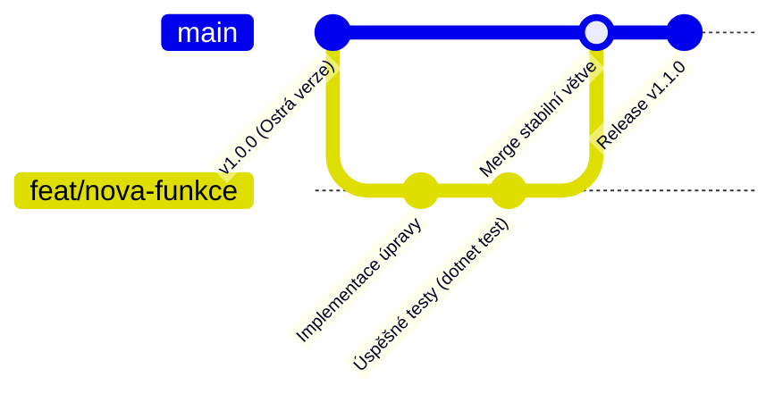

# QuestLock Gate – Vývojový a release workflow (Production Safety)

Tento dokument stanovuje závazná pravidla pro vývoj, verzování a nasazování nových verzí aplikace **QuestLock Gate** v produkčním režimu (jakmile je aplikace nainstalována na cílovém herním počítači).

---

## 1. Proč je ochrana hlavní větve (`main`) kritická

Aplikace QuestLock Gate není běžný desktopový program – integruje se hluboko do operačního systému Windows:
- Běží jako systémová služba s nejvyššími právy `NT AUTHORITY\SYSTEM`.
- Zprovozňuje nízkoúrovňový klávesový hook (`WH_KEYBOARD_LL`).
- Vytváří celoobrazovková `Topmost` překrytí přes všechny monitory.

> [!CAUTION]
> **Riziko zacyklení a DoS počítače:**  
> Pokud by se do produkčního balíčku dostala neošetřená chyba (crash při startu UI, deadlock v IPC nebo pád služby), bratrův počítač by mohl skončit v nepoužitelném stavu (černá obrazovka bez možnosti spustit hry či aplikace).  
> **Hlavní větev `main` je proto chráněná (Protected Branch) a přímý push do ní je zakázán.**

---

## 2. Větvení a vývojový cyklus (Branching Model)

Každá nová úprava, funkce i oprava chyby musí vznikat v izolované větvi:



### Konvence pojmenování větví:
- `feat/<nazev>` – nová funkcionalita (např. `feat/sound-effects`, `feat/division-custom-range`)
- `fix/<nazev>` – oprava chyby (např. `fix/numpad-clear-key`, `fix/firewall-rule`)
- `docs/<nazev>` – úprava dokumentace a specifikací
- `refactor/<nazev>` – čistění a refaktoring kódu bez změny chování

---

## 3. Sémantické verzování (SemVer: `MAJOR.MINOR.PATCH`)

Číslování verzí se řídí standardem **SemVer**:

| Typ změny | Příklad | Kdy použít |
| :--- | :--- | :--- |
| **PATCH** (Oprava) | `v1.0.0` → `v1.0.1` | Drobné opravy chyb, překlepů, úprava stylů, které nemění funkčnost ani kontrakty. |
| **MINOR** (Nová funkce) | `v1.0.0` → `v1.1.0` | Přidání nové vlastnosti (např. nová stránka v administraci, podpora nového typu úloh), zpětně plně kompatibilní. |
| **MAJOR** (Zásadní změna) | `v1.x.x` → `v2.0.0` | Změna systémové architektury, nekompatibilní změna IPC kontraktů nebo zásadní přepsání instalátoru. |

---

## 4. Kontrolní seznam před vydáním nové verze (Release Checklist)

Před sloučením větve do `main` a vytvořením nového release balíčku **MUSÍ** proběhnout:

1. **Ověření unit testů:**
   ```powershell
   dotnet test
   ```
   Všechny testy v `QuestLock.Core.Tests` musí projít bez jediné chyby.

2. **Zvýšení verze:**
   - Zvýšit číslo verze v projektových souborech (`QuestLock.Guardian.csproj`, `QuestLock.UI.csproj`, `QuestLock.Core.csproj`).
   - Zapsat nový záznam do `work-logs/YYYY-MM-DD.md`.

3. **Sloučení do `main`:**
   - Vytvoření Pull Requestu nebo lokální merge po schválení.

4. **Vygenerování Self-Contained instalačního balíčku:**
   ```powershell
   powershell -ExecutionPolicy Bypass -File scripts\package-release.ps1
   ```
   Skript vytvoří čistý `dist\QuestLock-Setup.zip` se zabudovaným .NET runtimem.

5. **Publikace GitHub Release:**
   - Vytvořit nový Git tag (např. `git tag v1.1.0` a `git push origin v1.1.0`).
   - Založit nový GitHub Release na webu nebo přes API a připojit `QuestLock-Setup.zip`.

6. **Bezpečná aktualizace na bratrově PC:**
   - Aktualizaci provádět zásadně v době, kdy má bratr splněno nebo když u počítače sedí správce.
